# SEMI Family — VCV Rack + 4ms MetaModule

Plugin ailesinin Eurorack serisi. Tek kaynak iki hedefe derlenir: VCV Rack 2 (`plugin.so` / `.vcvplugin`) ve 4ms MetaModule (`SemiFamily.mmplugin`). Paneller Early Cyber ile klasik Eurorack arası bir dilde: koyu panel, çerçeveli OLED ekranlar, eteklikli knob'lar ve somunlu jack'ler.

## Kurulum / Install

- **4ms MetaModule:** [Releases](../../releases/latest) sayfasından `SemiFamily.mmplugin` dosyasını indirip SD karta veya USB belleğe kopyalayın, MetaModule'de *Settings → Plugins* altından yükleyin. Download `SemiFamily.mmplugin` from [Releases](../../releases/latest), copy it to the SD card or a USB stick and load it under *Settings → Plugins*.
- **VCV Rack 2:** `.vcvplugin` dosyalarını (Linux / macOS / Windows) GitHub Actions derlemesinden alın ya da aşağıdaki gibi derleyin; dosyayı Rack kullanıcı klasöründeki `plugins-<os>-<cpu>/` altına koyun.

Her modülün kendi sayfası var: ekran görüntüsü, ne yaptığı, ilk patch, kontroller ve girişler/çıkışlar. Görüntüler gerçek VCV Rack'te canlı çalışırken çekildi (`tests/gui_shots.py`). Each module has its own page with a live screenshot, a description, a first patch and the full control / I/O list.

## Modules

<!-- gallery:start -->

<table>
<tr><td align="center" valign="bottom"><a href="docs/modules/Nexusclip.md">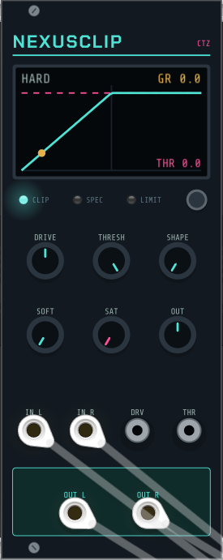</a><br><a href="docs/modules/Nexusclip.md"><b>NEXUSCLIP</b></a></td><td align="center" valign="bottom"><a href="docs/modules/Reticulum.md">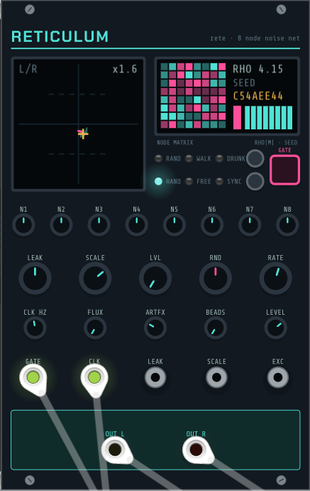</a><br><a href="docs/modules/Reticulum.md"><b>RETICULUM</b></a></td><td align="center" valign="bottom"><a href="docs/modules/Seedwalk.md">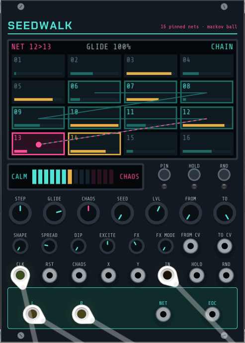</a><br><a href="docs/modules/Seedwalk.md"><b>SEEDWALK</b></a></td><td align="center" valign="bottom"><a href="docs/modules/Epoch.md">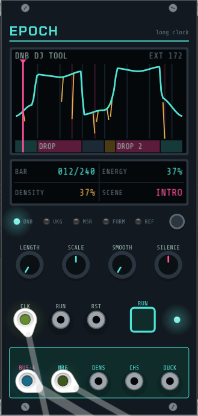</a><br><a href="docs/modules/Epoch.md"><b>EPOCH</b></a></td><td align="center" valign="bottom"><a href="docs/modules/Turnaround.md">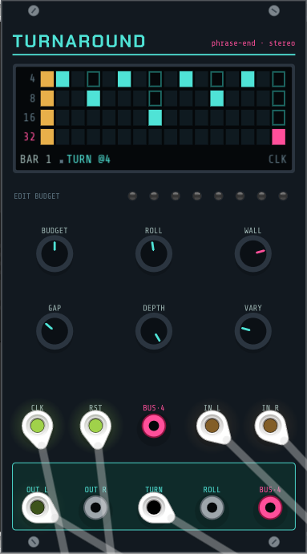</a><br><a href="docs/modules/Turnaround.md"><b>TURNAROUND</b></a></td></tr>
<tr><td align="center" valign="bottom"><a href="docs/modules/Floater.md">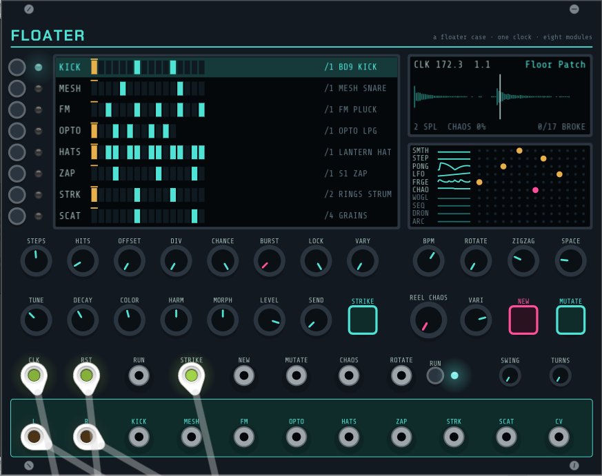</a><br><a href="docs/modules/Floater.md"><b>FLOATER</b></a></td><td align="center" valign="bottom"><a href="docs/modules/Floatdat.md">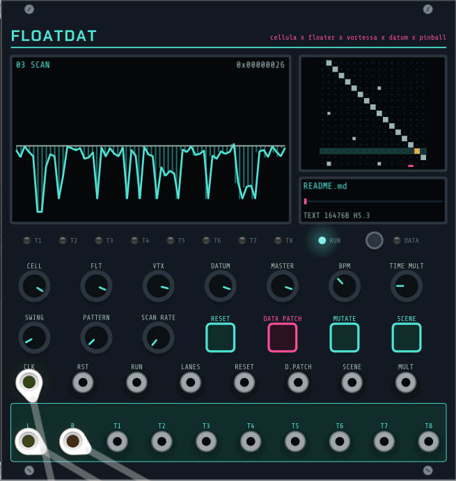</a><br><a href="docs/modules/Floatdat.md"><b>FLOATDAT</b></a></td><td align="center" valign="bottom"><a href="docs/modules/Splicebus.md">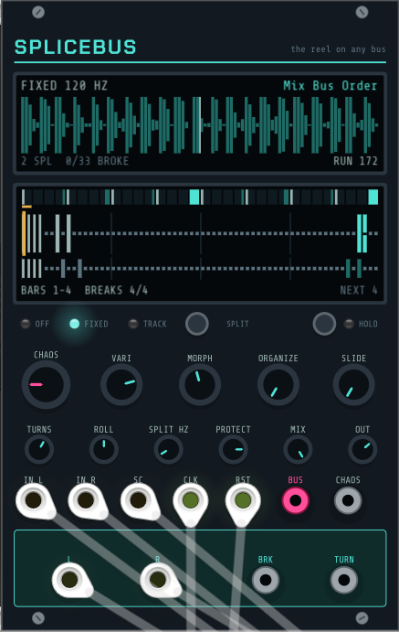</a><br><a href="docs/modules/Splicebus.md"><b>SPLICEBUS</b></a></td><td align="center" valign="bottom"><a href="docs/modules/Ikedar.md">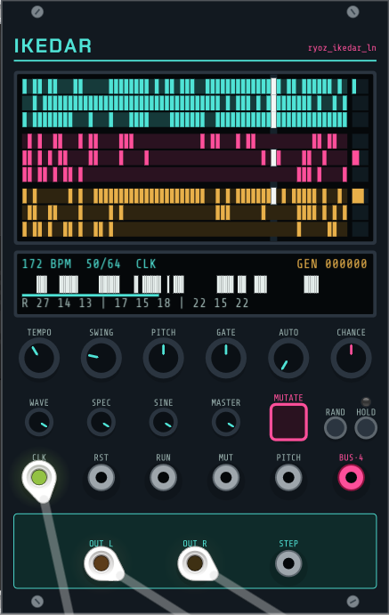</a><br><a href="docs/modules/Ikedar.md"><b>IKEDAR</b></a></td><td align="center" valign="bottom"><a href="docs/modules/Jdat.md">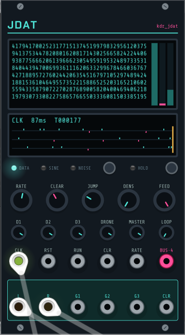</a><br><a href="docs/modules/Jdat.md"><b>JDAT</b></a></td></tr>
<tr><td align="center" valign="bottom"><a href="docs/modules/TstIngp.md">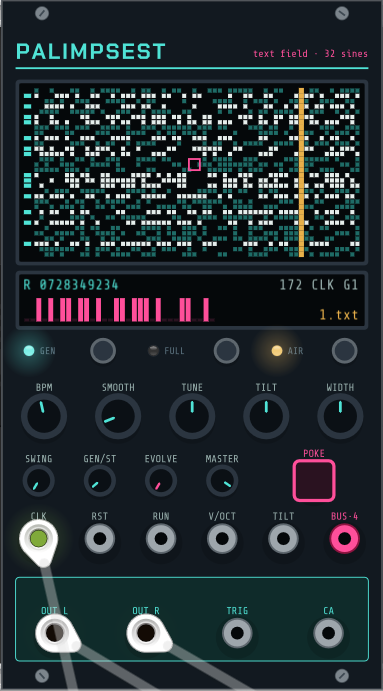</a><br><a href="docs/modules/TstIngp.md"><b>TST_INGP</b></a></td><td align="center" valign="bottom"><a href="docs/modules/Pindata.md">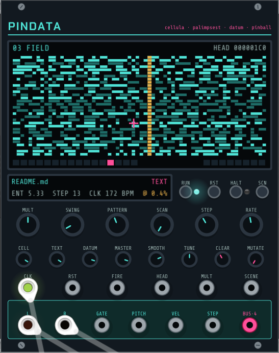</a><br><a href="docs/modules/Pindata.md"><b>PINDATA</b></a></td><td align="center" valign="bottom"><a href="docs/modules/Ikedat.md">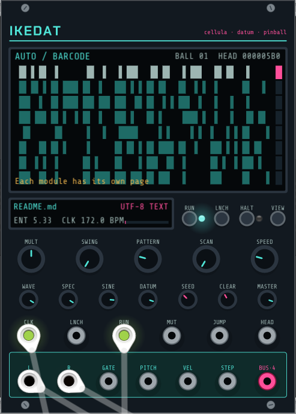</a><br><a href="docs/modules/Ikedat.md"><b>IKEDAT</b></a></td><td align="center" valign="bottom"><a href="docs/modules/Datascreen.md">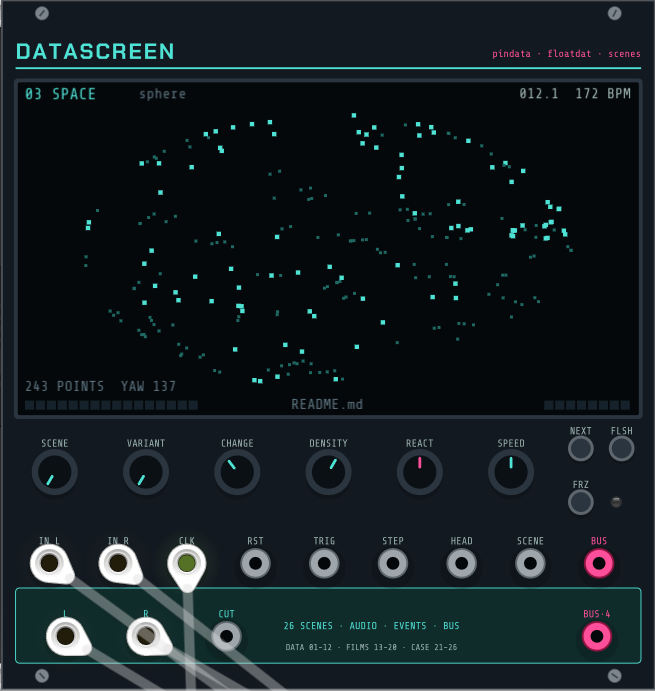</a><br><a href="docs/modules/Datascreen.md"><b>DATASCREEN</b></a></td><td align="center" valign="bottom"><a href="docs/modules/Breakdna.md">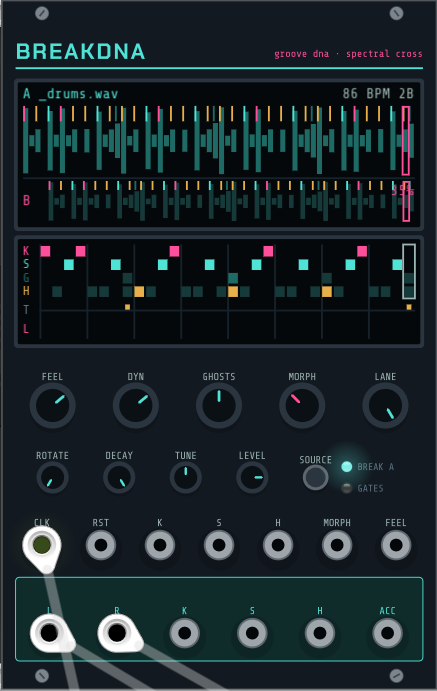</a><br><a href="docs/modules/Breakdna.md"><b>BREAKDNA</b></a></td></tr>
<tr><td align="center" valign="bottom"><a href="docs/modules/Genotype.md">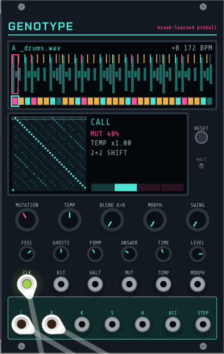</a><br><a href="docs/modules/Genotype.md"><b>GENOTYPE</b></a></td><td align="center" valign="bottom"><a href="docs/modules/Loopgenome.md"></a><br><a href="docs/modules/Loopgenome.md"><b>LOOPGENOME</b></a></td><td align="center" valign="bottom"><a href="docs/modules/Breakmed.md">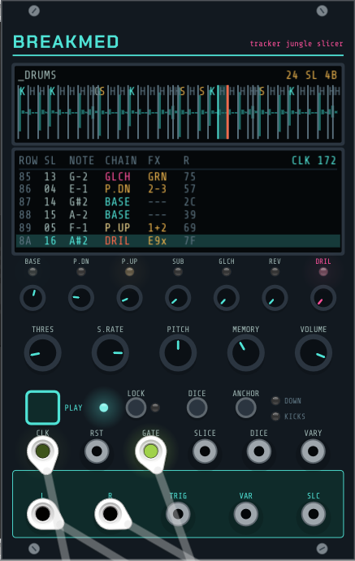</a><br><a href="docs/modules/Breakmed.md"><b>BREAKMED</b></a></td><td align="center" valign="bottom"><a href="docs/modules/Breakslicer.md">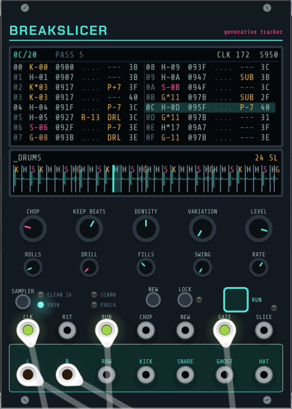</a><br><a href="docs/modules/Breakslicer.md"><b>BREAKSLICER</b></a></td><td align="center" valign="bottom"><a href="docs/modules/Breakbeat.md">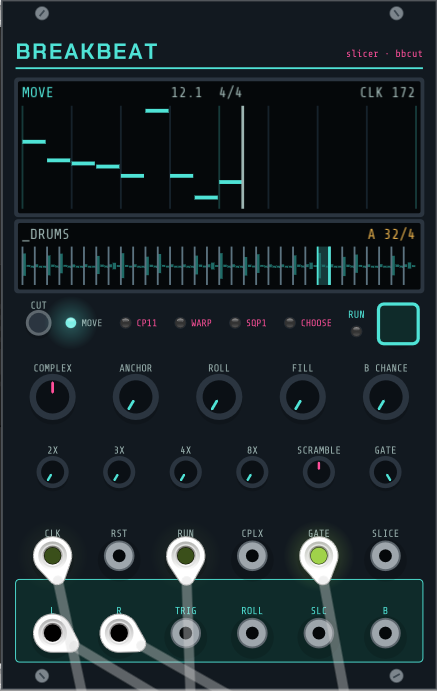</a><br><a href="docs/modules/Breakbeat.md"><b>BREAKBEAT</b></a></td></tr>
<tr><td align="center" valign="bottom"><a href="docs/modules/Neurostack.md">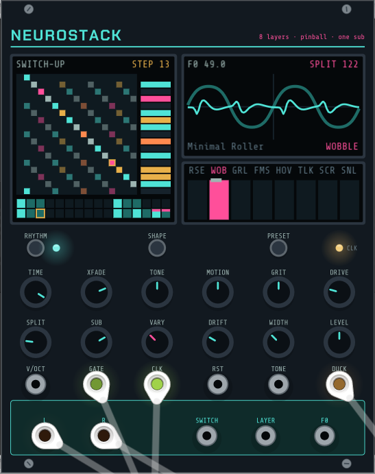</a><br><a href="docs/modules/Neurostack.md"><b>NEUROSTACK</b></a></td><td align="center" valign="bottom"><a href="docs/modules/Snarestack.md">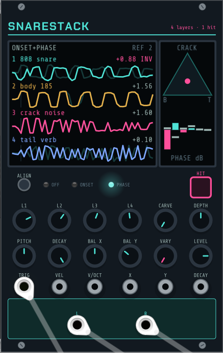</a><br><a href="docs/modules/Snarestack.md"><b>SNARESTACK</b></a></td><td align="center" valign="bottom"><a href="docs/modules/Substrate.md">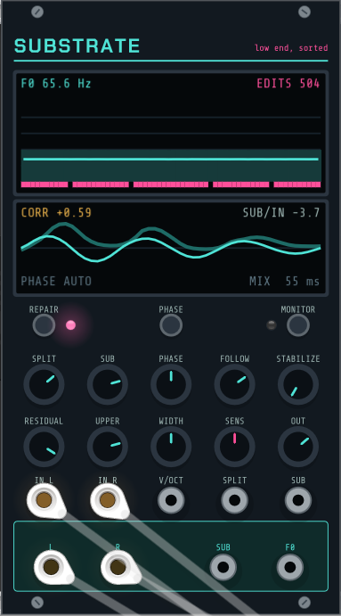</a><br><a href="docs/modules/Substrate.md"><b>SUBSTRATE</b></a></td><td align="center" valign="bottom"><a href="docs/modules/Drop2.md">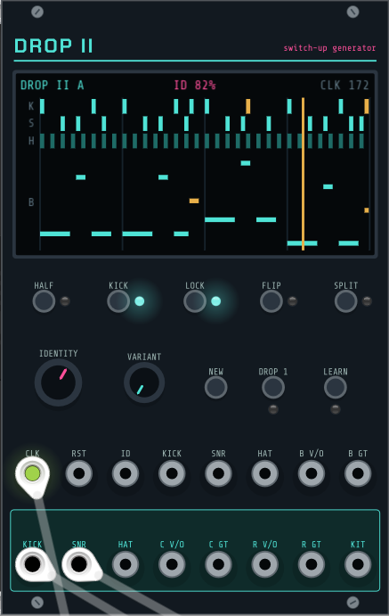</a><br><a href="docs/modules/Drop2.md"><b>DROP II</b></a></td><td align="center" valign="bottom"><a href="docs/modules/CallResponse.md">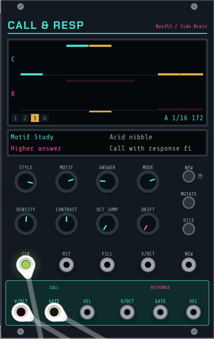</a><br><a href="docs/modules/CallResponse.md"><b>CALL & RESPONSE</b></a></td></tr>
<tr><td align="center" valign="bottom"><a href="docs/modules/Acid.md">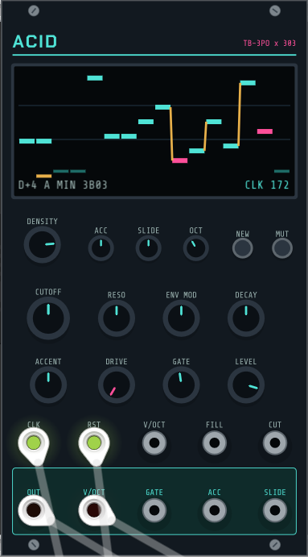</a><br><a href="docs/modules/Acid.md"><b>ACID</b></a></td><td align="center" valign="bottom"><a href="docs/modules/Quanta.md">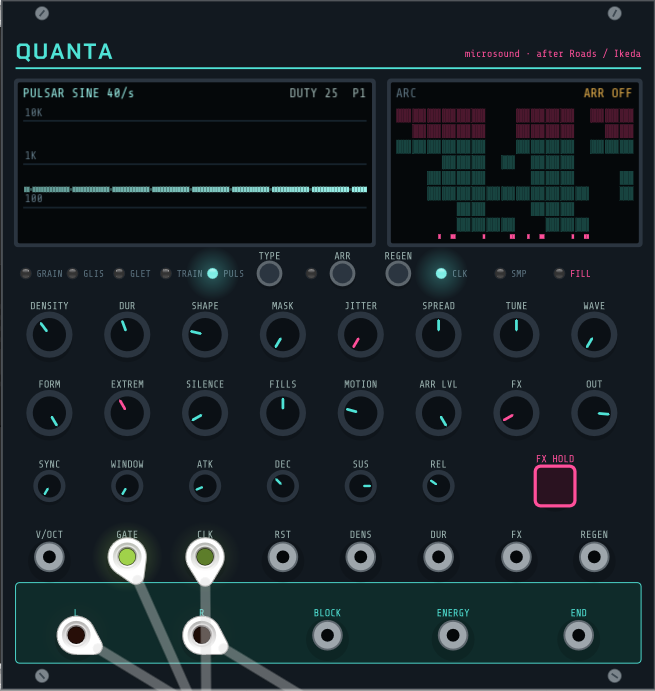</a><br><a href="docs/modules/Quanta.md"><b>QUANTA</b></a></td><td align="center" valign="bottom"><a href="docs/modules/Illusorium.md">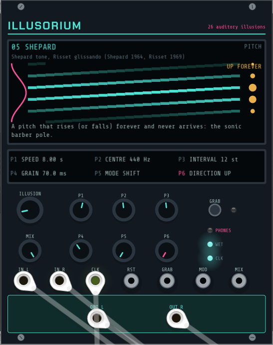</a><br><a href="docs/modules/Illusorium.md"><b>ILLUSORIUM</b></a></td><td align="center" valign="bottom"><a href="docs/modules/Vertex.md">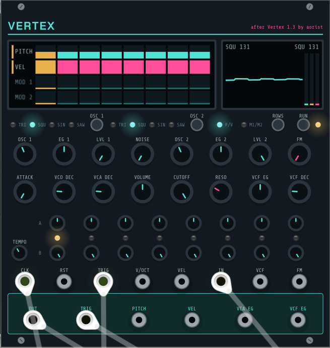</a><br><a href="docs/modules/Vertex.md"><b>VERTEX</b></a></td><td align="center" valign="bottom"><a href="docs/modules/Nms.md">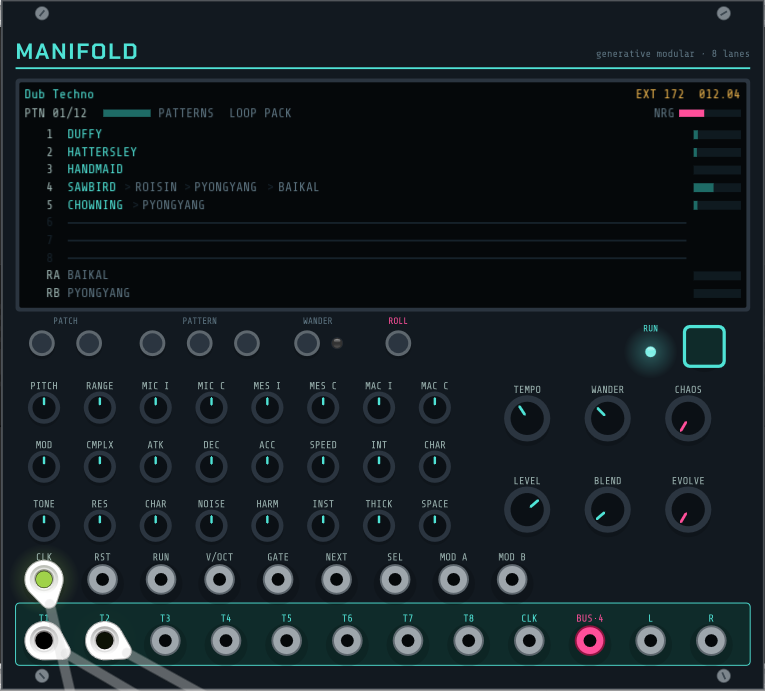</a><br><a href="docs/modules/Nms.md"><b>N.M.S.</b></a></td></tr>
<tr><td align="center" valign="bottom"><a href="docs/modules/Modport.md">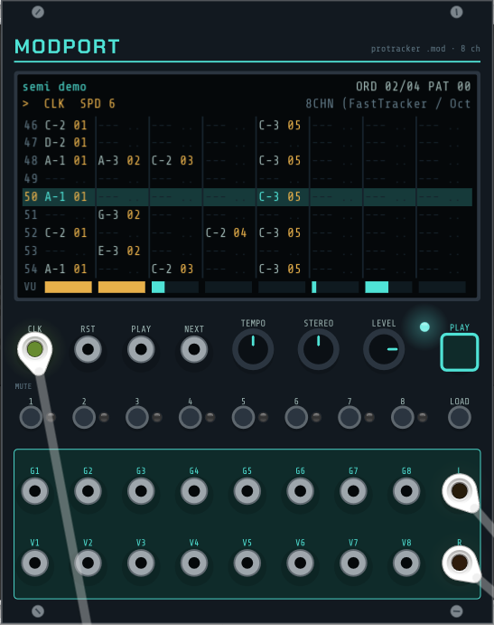</a><br><a href="docs/modules/Modport.md"><b>MODPORT</b></a></td><td align="center" valign="bottom"><a href="docs/modules/Dubplate.md">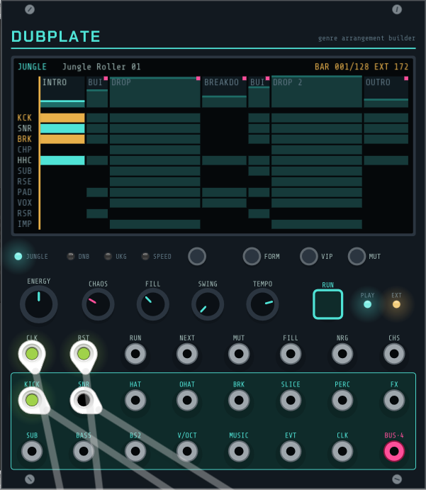</a><br><a href="docs/modules/Dubplate.md"><b>DUBPLATE</b></a></td><td align="center" valign="bottom"><a href="docs/modules/Conduit.md">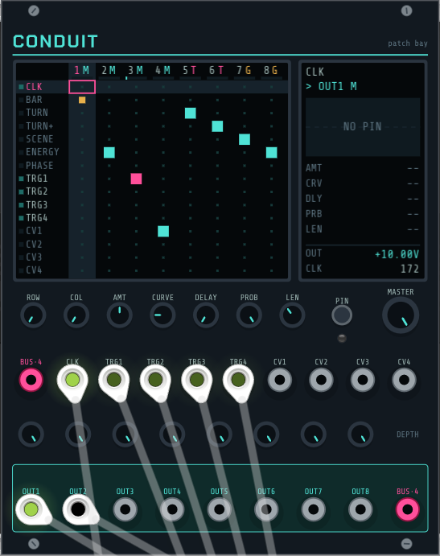</a><br><a href="docs/modules/Conduit.md"><b>CONDUIT</b></a></td><td align="center" valign="bottom"><a href="docs/modules/Blackbox.md">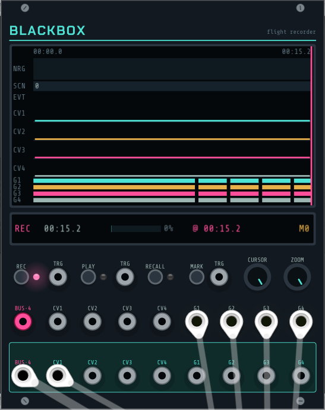</a><br><a href="docs/modules/Blackbox.md"><b>BLACKBOX</b></a></td><td align="center" valign="bottom"><a href="docs/modules/Setbook.md">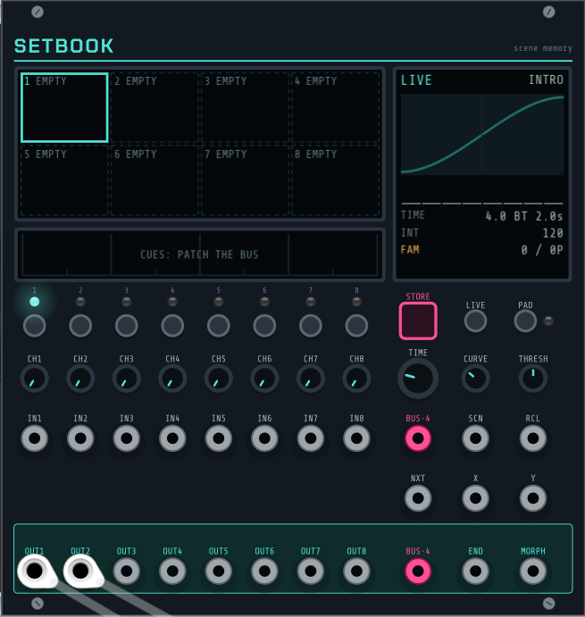</a><br><a href="docs/modules/Setbook.md"><b>SETBOOK</b></a></td></tr>
</table>

| module | what it does |
|---|---|
| [NEXUSCLIP](docs/modules/Nexusclip.md) | Clipper: drive and saturation into CLIP (seven curves), SPECTRAL or LIMIT at a hard ceiling, with a live transfer-curve screen |
| [RETICULUM](docs/modules/Reticulum.md) | Eight-node rete noise net with Lissajous scope, node matrix and drunk/walk/random modulation |
| [SEEDWALK](docs/modules/Seedwalk.md) | Markov ball walking sixteen pinned rete nets with glided matrix interpolation; walk range, hold and per-net randomise |
| [EPOCH](docs/modules/Epoch.md) | Long clock: a macro timeline of energy and silence that conducts the family over the BUS cable |
| [TURNAROUND](docs/modules/Turnaround.md) | Stereo phrase-end modulator: 4/8/16/32 bar turns, edit budget, rolls, wall and landing gap |
| [FLOATER](docs/modules/Floater.md) | A floater case: one clock, a rotating divider, eight Euclidean lanes with chance and bursts, Plaits / Braids / Clouds / Beads modules, a pin matrix and the REEL |
| [FLOATDAT](docs/modules/Floatdat.md) | IKEDAR x FLOATER x VORTESSA x JDAT played by the Pinball 2 Markov sequencer; any file is the material, drawn as datamatic scenes |
| [SPLICEBUS](docs/modules/Splicebus.md) | FLOATER's REEL as a bus effect: splices and genes on the clock, ORDER <> CHAOS over a split that keeps the bass whole, TURNAROUND's phrase form |
| [IKEDAR](docs/modules/Ikedar.md) | ryoz_ikedar_ln: nine 64-cell automata as rhythm, wavetable and FFT mask; sine/click datamatics voice with bit-matrix and barcode screens |
| [JDAT](docs/modules/Jdat.md) | kdr_jdat: a metro writes random (or any file's) data into three 512-sample buffers read as sound; LCD digit field, buffer barcodes, gate outs |
| [TST_INGP](docs/modules/TstIngp.md) | tst_ingp: text as a 64 x 32 bit field read by 32 sines, a cellular-automaton cursor rewriting it as it plays; field and rule screens |
| [PINDATA](docs/modules/Pindata.md) | IKEDAR x tst_ingp x JDAT played by the Pinball 2 Markov sequencer, fed by any file; datamatic scenes, lane gate/pitch/velocity outs, BUS |
| [IKEDAT](docs/modules/Ikedat.md) | ikedar x jdat x Pinball 2: a datamatic instrument fed by any file, live datamatics visuals as the UI, lane gate/pitch/velocity outs, BUS |
| [DATASCREEN](docs/modules/Datascreen.md) | The family's visual hub: one big screen rendering 26 datamatic scenes (PINDATA, FLOATDAT films, case/reel/orbit/attractor/vortex/ghost) from audio, lane/step events, the BUS cable and any file |
| [BREAKDNA](docs/modules/Breakdna.md) | Groove-DNA transfer and A/B spectral cross-synthesis of two breaks, clocked |
| [GENOTYPE](docs/modules/Genotype.md) | Break-learned Pinball Markov walk: the walk a break wants, learned from its DNA |
| [LOOPGENOME](docs/modules/Loopgenome.md) | Drums and neuro bass learned as one loop; one Pinball ball picks the drum slice and the bass articulation |
| [BREAKMED](docs/modules/Breakmed.md) | Generative tracker jungle break slicer: weighted chains (pitch, sub, glitch, reverse, drill), Paula sampler, hit log |
| [BREAKSLICER](docs/modules/Breakslicer.md) | Generative tracker break slicer: onset analysis, Markov pattern with 09xx / Rxy / drills, routing matrix, S950 / S1000 / Paula samplers |
| [BREAKBEAT](docs/modules/Breakbeat.md) | schwung-breakbeat slicer with BBCut cut procedures (CutProc11, WarpCut, SQPusher1, ChooseCut), loop A/B phrase, retriggers, cut display |
| [NEUROSTACK](docs/modules/Neurostack.md) | Neuro bass voice: eight layers on one phase switched by the Pinball Markov walk, a 32-step rhythm, pitch-tracked split over one clean sub |
| [SNARESTACK](docs/modules/Snarestack.md) | Four snare layers (built-in or WAV) aligned in time and phase into one hit, re-weighted as crack / body / tail |
| [SUBSTRATE](docs/modules/Substrate.md) | Automatic DnB low end: pitch-tracked mono split, a rebuilt phase-continuous sub, edit repair; low-end map and phase scope |
| [DROP II](docs/modules/Drop2.md) | Drop-2 switch-up generator for DnB: from drop-1 drums + bass and IDENTITY it writes drop 2 (half-time, kick shift, bass lock, flip, call/response) |
| [CALL & RESPONSE](docs/modules/CallResponse.md) | Call and response phrase generator (Side Brain C&R Generator / Nordl3, MIT): two mono voices as V/OCT, gate and velocity |
| [ACID](docs/modules/Acid.md) | TB-3PO x 303: generative acid line (Phazerville TB-3PO) and its 303 voice (schwung-303 / Open303), with the line as V/OCT, gate, accent and slide |
| [QUANTA](docs/modules/Quanta.md) | Microsound particle synth after Curtis Roads (grain, glisson, grainlet, trainlet, pulsar) with an arrangement generator after Ryoji Ikeda's structures |
| [ILLUSORIUM](docs/modules/Illusorium.md) | 26 psychoacoustic illusions as one stereo effect (Shepard, Risset, Deutsch, Huggins, Zwicker, Warren, Bregman, Haas, Franssen and more), one at a time |
| [VERTEX](docs/modules/Vertex.md) | Percussion voice after Vertex 1.3 by aorist (aorist.io, Max for Live): two oscillators, noise, Sallen & Key filter (port of sm.sallenkey~ by Surreal Machines), three envelopes and four 8-step rows |
| [N.M.S.](docs/modules/Nms.md) | Modular rebuild of Tim Exile's NMS (New Modular System): generative factory patches on 8 channel lanes, 24 macros, patterns, WANDER, CHAOS |
| [MODPORT](docs/modules/Modport.md) | ProTracker .mod player (1-8 channels, pt2-clone replayer): one row per clock or free tempo, per-channel gate and V/OCT, Amiga stereo mix |
| [DUBPLATE](docs/modules/Dubplate.md) | Genre arrangement builder (jungle, DnB, UK garage, speed garage): template sections and role lanes as gates, fills, variations, FX events, FamilyBus |
| [CONDUIT](docs/modules/Conduit.md) | Family patch bay: BUS + trigger / CV rows into a pin matrix (amount, curve, delay, probability, length) driving 8 CV / trigger / gate outputs |
| [BLACKBOX](docs/modules/Blackbox.md) | Family flight recorder: records the BUS and 4 CV + 4 gate lanes into a ring buffer, replay / recall from a cursor, MIDI file export |
| [SETBOOK](docs/modules/Setbook.md) | Family scene memory: 8 scenes x 8 CV channels with timed morph, curves, X/Y pad, BUS scene / EPOCH cues; in Rack also morphs every SEMI module's knobs |

<!-- gallery:end -->

35 modül. Motorlar plugin repolarından mümkün olduğunca değiştirilmeden kopyalandı. Değişen yerler her motorun `sources.mk` dosyasında yazıyor.

## Derleme

```sh
# VCV Rack (Rack SDK 2.6.x)
make RACK_DIR=/path/to/Rack-SDK -j8 && make dist RACK_DIR=/path/to/Rack-SDK

# MetaModule (arm-none-eabi-gcc 12.2/12.3/15.3 PATH'te)
cmake -S metamodule -B build/mm -G Ninja -DMETAMODULE_SDK_DIR=/path/to/metamodule-plugin-sdk
cmake --build build/mm            # -> dist/metamodule/SemiFamily.mmplugin

# Paneller (SVG + 240 px PNG + layout başlıkları), tek kaynak: tools/panels/*.py
pip install fonttools cairosvg && python3 tools/panelgen.py
```

## BUS kablosu (FamilyBus CV)

Dört kanallı tek bir poly kablo kullanılır, çünkü MetaModule poly kabloyu 4 sesle sınırlıyor. Kanallar: POS, ENERGY, SCENE, EVENT. Ayrıntılar `src/common/FamilyBusCV.hpp` dosyasında. Örnek zincir: EPOCH `BUS·4` → TURNAROUND `BUS·4` → (sonraki kardeş).

## Belgeler

- `docs/METAMODULE_DISPLAY.md`: MetaModule ekran kuralları (yenileme hızı, katman, kırpma, çizgi kalınlığı, bellek bütçesi)
- `docs/PORTING.md`: yeni bir plugin'i seriye taşımanın beş adımı
- `tests/`: motorların çevrimdışı testleri (plugin build'ine dahil değil)

GPL-3.0-or-later. Üçüncü parti kodlar (stmlib, Beads: MIT; artifex/forsitan: GPL-3.0) `engines/thirdparty` altında, kendi lisanslarıyla.

## Yayın öncesi lisans notları

- VERTEX: orijinal M4L cihazının (aorist) lisansı yok, kamuya açık yayından önce izin gerekiyor.
- NMS: Tim Exile'ın Reaktor paketinden; yayından önce izin isteyin (engines/nms/NOTICE.md).
- TST_INGP: gömülü örnek metinler ve SDIF analizleri yazarlarından onay gerektiriyor.
- CALL & RESPONSE: Nordl3 motoru MIT; Side Brain katmanının lisansı belirtilmemiş.
- ACID / FLOATER / RETICULUM: GPL-3.0 kod içeriyor (schwung-303, TB-3PO, artifex), paket GPL-3.0-or-later.
