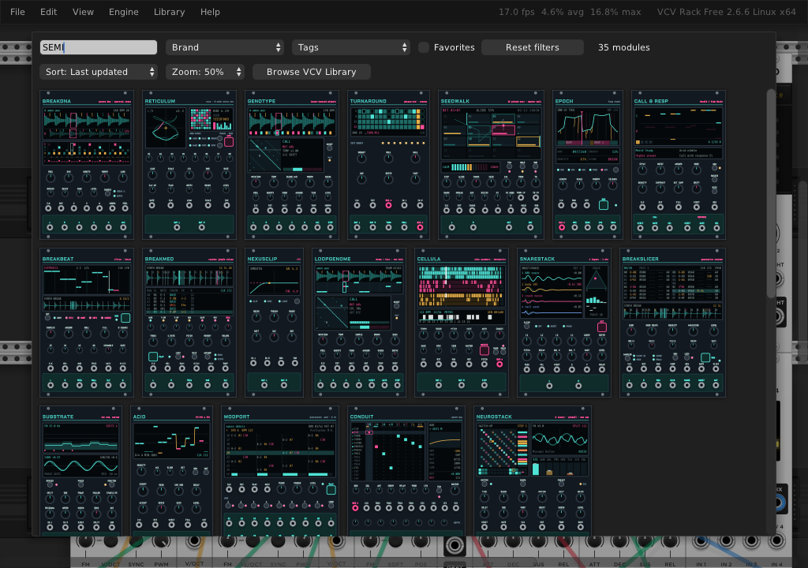

# SEMI Family — VCV Rack + 4ms MetaModule

The Eurorack series of the SEMI plugin family: 35 modules from one source tree, built for VCV Rack 2 (`plugin.so` / `.vcvplugin`) and the 4ms MetaModule (`SemiFamily.mmplugin`). The panels sit between Early Cyber and classic Eurorack: dark faceplates, framed OLED-style screens, skirted knobs and nut jacks.

## Install

- **4ms MetaModule:** download [`release/SemiFamily.mmplugin`](release/SemiFamily.mmplugin) (*Download raw*), copy it to the SD card or a USB stick and load it under *Settings → Plugins*. Release notes: [release/NOTES.md](release/NOTES.md).
- **VCV Rack 2** (2.6.x): build and install it with the [Rack SDK](https://vcvrack.com/downloads/) for your computer (`Rack-SDK-2.6.6-mac-arm64` on an Apple Silicon Mac):

  ```sh
  xcode-select --install && brew install zstd      # macOS, once
  tools/install-rack.sh ~/Downloads/Rack-SDK
  ```

  This puts `SemiFamily-<version>-<os>-<cpu>.vcvplugin` in the `plugins-<os>-<cpu>/` folder of your Rack user folder (macOS: `~/Library/Application Support/Rack2/plugins-mac-arm64/`). A `.vcvplugin` from somewhere else (the GitHub Actions build, a friend's Mac) goes in the same folder. Quit and reopen Rack: it unpacks the plugin on start. Right-click the rack (or press Enter) and type **SEMI**: all 35 modules are there. If they are not, `log.txt` in the Rack user folder says why.

  

Each module has its own page with a screenshot, what it does, a first patch, and its full list of controls, inputs and outputs. The screenshots were taken with the modules running live in VCV Rack (`tests/gui_shots.py`).

## Modules

<!-- gallery:start -->

<table>
<tr><td align="center" valign="bottom"><a href="docs/modules/Nexusclip.md"></a><br><a href="docs/modules/Nexusclip.md"><b>NEXUSCLIP</b></a></td><td align="center" valign="bottom"><a href="docs/modules/Reticulum.md"></a><br><a href="docs/modules/Reticulum.md"><b>RETICULUM</b></a></td><td align="center" valign="bottom"><a href="docs/modules/Seedwalk.md"></a><br><a href="docs/modules/Seedwalk.md"><b>SEEDWALK</b></a></td><td align="center" valign="bottom"><a href="docs/modules/Epoch.md"></a><br><a href="docs/modules/Epoch.md"><b>EPOCH</b></a></td><td align="center" valign="bottom"><a href="docs/modules/Turnaround.md"></a><br><a href="docs/modules/Turnaround.md"><b>TURNAROUND</b></a></td></tr>
<tr><td align="center" valign="bottom"><a href="docs/modules/Floater.md"></a><br><a href="docs/modules/Floater.md"><b>FLOATER</b></a></td><td align="center" valign="bottom"><a href="docs/modules/Floatdat.md"></a><br><a href="docs/modules/Floatdat.md"><b>FLOATDAT</b></a></td><td align="center" valign="bottom"><a href="docs/modules/Splicebus.md"></a><br><a href="docs/modules/Splicebus.md"><b>SPLICEBUS</b></a></td><td align="center" valign="bottom"><a href="docs/modules/Ikedar.md"></a><br><a href="docs/modules/Ikedar.md"><b>CELLULA</b></a></td><td align="center" valign="bottom"><a href="docs/modules/Jdat.md"></a><br><a href="docs/modules/Jdat.md"><b>DATUM</b></a></td></tr>
<tr><td align="center" valign="bottom"><a href="docs/modules/TstIngp.md"></a><br><a href="docs/modules/TstIngp.md"><b>PALIMPSEST</b></a></td><td align="center" valign="bottom"><a href="docs/modules/Pindata.md"></a><br><a href="docs/modules/Pindata.md"><b>PINDATA</b></a></td><td align="center" valign="bottom"><a href="docs/modules/Ikedat.md"></a><br><a href="docs/modules/Ikedat.md"><b>IKEDAT</b></a></td><td align="center" valign="bottom"><a href="docs/modules/Datascreen.md"></a><br><a href="docs/modules/Datascreen.md"><b>DATASCREEN</b></a></td><td align="center" valign="bottom"><a href="docs/modules/Breakdna.md"></a><br><a href="docs/modules/Breakdna.md"><b>BREAKDNA</b></a></td></tr>
<tr><td align="center" valign="bottom"><a href="docs/modules/Genotype.md"></a><br><a href="docs/modules/Genotype.md"><b>GENOTYPE</b></a></td><td align="center" valign="bottom"><a href="docs/modules/Loopgenome.md"></a><br><a href="docs/modules/Loopgenome.md"><b>LOOPGENOME</b></a></td><td align="center" valign="bottom"><a href="docs/modules/Breakmed.md"></a><br><a href="docs/modules/Breakmed.md"><b>BREAKMED</b></a></td><td align="center" valign="bottom"><a href="docs/modules/Breakslicer.md"></a><br><a href="docs/modules/Breakslicer.md"><b>BREAKSLICER</b></a></td><td align="center" valign="bottom"><a href="docs/modules/Breakbeat.md"></a><br><a href="docs/modules/Breakbeat.md"><b>BREAKBEAT</b></a></td></tr>
<tr><td align="center" valign="bottom"><a href="docs/modules/Neurostack.md"></a><br><a href="docs/modules/Neurostack.md"><b>NEUROSTACK</b></a></td><td align="center" valign="bottom"><a href="docs/modules/Snarestack.md"></a><br><a href="docs/modules/Snarestack.md"><b>SNARESTACK</b></a></td><td align="center" valign="bottom"><a href="docs/modules/Substrate.md"></a><br><a href="docs/modules/Substrate.md"><b>SUBSTRATE</b></a></td><td align="center" valign="bottom"><a href="docs/modules/Drop2.md"></a><br><a href="docs/modules/Drop2.md"><b>DROP II</b></a></td><td align="center" valign="bottom"><a href="docs/modules/CallResponse.md"></a><br><a href="docs/modules/CallResponse.md"><b>CALL & RESPONSE</b></a></td></tr>
<tr><td align="center" valign="bottom"><a href="docs/modules/Acid.md"></a><br><a href="docs/modules/Acid.md"><b>ACID</b></a></td><td align="center" valign="bottom"><a href="docs/modules/Quanta.md"></a><br><a href="docs/modules/Quanta.md"><b>QUANTA</b></a></td><td align="center" valign="bottom"><a href="docs/modules/Illusorium.md"></a><br><a href="docs/modules/Illusorium.md"><b>ILLUSORIUM</b></a></td><td align="center" valign="bottom"><a href="docs/modules/Vertex.md"></a><br><a href="docs/modules/Vertex.md"><b>TYMPAN</b></a></td><td align="center" valign="bottom"><a href="docs/modules/Nms.md"></a><br><a href="docs/modules/Nms.md"><b>MANIFOLD</b></a></td></tr>
<tr><td align="center" valign="bottom"><a href="docs/modules/Modport.md"></a><br><a href="docs/modules/Modport.md"><b>MODPORT</b></a></td><td align="center" valign="bottom"><a href="docs/modules/Dubplate.md"></a><br><a href="docs/modules/Dubplate.md"><b>DUBPLATE</b></a></td><td align="center" valign="bottom"><a href="docs/modules/Conduit.md"></a><br><a href="docs/modules/Conduit.md"><b>CONDUIT</b></a></td><td align="center" valign="bottom"><a href="docs/modules/Blackbox.md"></a><br><a href="docs/modules/Blackbox.md"><b>BLACKBOX</b></a></td><td align="center" valign="bottom"><a href="docs/modules/Setbook.md"></a><br><a href="docs/modules/Setbook.md"><b>SETBOOK</b></a></td></tr>
</table>

| module | what it does |
|---|---|
| [NEXUSCLIP](docs/modules/Nexusclip.md) | Clipper: drive and saturation into CLIP (seven curves), SPECTRAL or LIMIT at a hard ceiling, with a live transfer-curve screen |
| [RETICULUM](docs/modules/Reticulum.md) | Eight-node rete noise net with Lissajous scope, node matrix and drunk/walk/random modulation |
| [SEEDWALK](docs/modules/Seedwalk.md) | Markov ball walking sixteen pinned rete nets with glided matrix interpolation; walk range, hold and per-net randomise |
| [EPOCH](docs/modules/Epoch.md) | Long clock: a macro timeline of energy and silence that conducts the family over the BUS cable |
| [TURNAROUND](docs/modules/Turnaround.md) | Stereo phrase-end modulator: 4/8/16/32 bar turns, edit budget, rolls, wall and landing gap |
| [FLOATER](docs/modules/Floater.md) | A floater case: one clock, a rotating divider, eight Euclidean lanes with chance and bursts, macro-oscillator, granular and texture voices (Mutable Instruments open-source DSP), a pin matrix and the REEL |
| [FLOATDAT](docs/modules/Floatdat.md) | CELLULA x FLOATER x VORTESSA x DATUM played by a Markov pinball sequencer; any file is the material, drawn as datamatic scenes |
| [SPLICEBUS](docs/modules/Splicebus.md) | FLOATER's REEL as a bus effect: splices and genes on the clock, ORDER <> CHAOS over a split that keeps the bass whole, TURNAROUND's phrase form |
| [CELLULA](docs/modules/Ikedar.md) | Nine 64-cell automata as rhythm, wavetable and FFT mask; sine/click datamatics voice with bit-matrix and barcode screens |
| [DATUM](docs/modules/Jdat.md) | A metro writes random (or any file's) data into three 512-sample buffers read as sound; LCD digit field, buffer barcodes, gate outs |
| [PALIMPSEST](docs/modules/TstIngp.md) | Text as a 64 x 32 bit field read by 32 sines, a cellular-automaton cursor rewriting it as it plays; field and rule screens |
| [PINDATA](docs/modules/Pindata.md) | CELLULA x PALIMPSEST x DATUM played by a Markov pinball sequencer, fed by any file; datamatic scenes, lane gate/pitch/velocity outs, BUS |
| [IKEDAT](docs/modules/Ikedat.md) | CELLULA x DATUM x a Markov pinball: a datamatic instrument fed by any file, live datamatics visuals as the UI, lane gate/pitch/velocity outs, BUS |
| [DATASCREEN](docs/modules/Datascreen.md) | The family's visual hub: one big screen rendering 26 datamatic scenes (PINDATA, FLOATDAT films, case/reel/orbit/attractor/vortex/ghost) from audio, lane/step events, the BUS cable and any file |
| [BREAKDNA](docs/modules/Breakdna.md) | Groove-DNA transfer and A/B spectral cross-synthesis of two breaks, clocked |
| [GENOTYPE](docs/modules/Genotype.md) | Break-learned Pinball Markov walk: the walk a break wants, learned from its DNA |
| [LOOPGENOME](docs/modules/Loopgenome.md) | Drums and neuro bass learned as one loop; one Pinball ball picks the drum slice and the bass articulation |
| [BREAKMED](docs/modules/Breakmed.md) | Generative tracker jungle break slicer: weighted chains (pitch, sub, glitch, reverse, drill), Paula sampler, hit log |
| [BREAKSLICER](docs/modules/Breakslicer.md) | Generative tracker break slicer: onset analysis, Markov pattern with 09xx / Rxy / drills, routing matrix, S950 / S1000 / Paula samplers |
| [BREAKBEAT](docs/modules/Breakbeat.md) | schwung-breakbeat slicer with BBCut cut procedures (CutProc11, WarpCut, SQPusher1, ChooseCut), loop A/B phrase, retriggers, cut display |
| [NEUROSTACK](docs/modules/Neurostack.md) | Neuro bass voice: eight layers on one phase switched by the Pinball Markov walk, a 32-step rhythm, pitch-tracked split over one clean sub |
| [SNARESTACK](docs/modules/Snarestack.md) | Four snare layers (built-in or WAV) aligned in time and phase into one hit, re-weighted as crack / body / tail |
| [SUBSTRATE](docs/modules/Substrate.md) | Automatic DnB low end: pitch-tracked mono split, a rebuilt phase-continuous sub, edit repair; low-end map and phase scope |
| [DROP II](docs/modules/Drop2.md) | Drop-2 switch-up generator for DnB: from drop-1 drums + bass and IDENTITY it writes drop 2 (half-time, kick shift, bass lock, flip, call/response) |
| [CALL & RESPONSE](docs/modules/CallResponse.md) | Call and response phrase generator (Side Brain C&R Generator / Nordl3, MIT): two mono voices as V/OCT, gate and velocity |
| [ACID](docs/modules/Acid.md) | TB-3PO x 303: generative acid line (Phazerville TB-3PO) and its 303 voice (schwung-303 / Open303), with the line as V/OCT, gate, accent and slide |
| [QUANTA](docs/modules/Quanta.md) | Microsound particle synth after Curtis Roads (grain, glisson, grainlet, trainlet, pulsar) with an arrangement generator after Ryoji Ikeda's structures |
| [ILLUSORIUM](docs/modules/Illusorium.md) | 26 psychoacoustic illusions as one stereo effect (Shepard, Risset, Deutsch, Huggins, Zwicker, Warren, Bregman, Haas, Franssen and more), one at a time |
| [TYMPAN](docs/modules/Vertex.md) | Percussion voice: two oscillators, noise, a Sallen & Key filter, three envelopes and four 8-step rows (PITCH, VEL, MOD 1, MOD 2) |
| [MANIFOLD](docs/modules/Nms.md) | Generative modular instrument: factory patches of generators and FX on 8 channel lanes, 24 macros, patterns, WANDER, CHAOS |
| [MODPORT](docs/modules/Modport.md) | ProTracker .mod player (1-8 channels, pt2-clone replayer): one row per clock or free tempo, per-channel gate and V/OCT, Amiga stereo mix |
| [DUBPLATE](docs/modules/Dubplate.md) | Genre arrangement builder (jungle, DnB, UK garage, speed garage): template sections and role lanes as gates, fills, variations, FX events, FamilyBus |
| [CONDUIT](docs/modules/Conduit.md) | Family patch bay: BUS + trigger / CV rows into a pin matrix (amount, curve, delay, probability, length) driving 8 CV / trigger / gate outputs |
| [BLACKBOX](docs/modules/Blackbox.md) | Family flight recorder: records the BUS and 4 CV + 4 gate lanes into a ring buffer, replay / recall from a cursor, MIDI file export |
| [SETBOOK](docs/modules/Setbook.md) | Family scene memory: 8 scenes x 8 CV channels with timed morph, curves, X/Y pad, BUS scene / EPOCH cues; in Rack also morphs every SEMI module's knobs |

<!-- gallery:end -->

The engines are copied from the plugin repositories with as few changes as possible; every change is listed in that engine's `sources.mk`.

## Building

```sh
# VCV Rack (Rack SDK 2.6.x)
make RACK_DIR=/path/to/Rack-SDK -j8 && make dist RACK_DIR=/path/to/Rack-SDK

# MetaModule (arm-none-eabi-gcc 12.2 / 12.3 / 15.3 on PATH)
cmake -S metamodule -B build/mm -G Ninja -DMETAMODULE_SDK_DIR=/path/to/metamodule-plugin-sdk
cmake --build build/mm            # -> dist/metamodule/SemiFamily.mmplugin

# Panels (SVG + 240 px PNG + layout headers), single source: tools/panels/*.py
pip install fonttools cairosvg && python3 tools/panelgen.py
```

## The BUS cable (FamilyBus CV)

The modules talk over one 4-channel poly cable, because the MetaModule limits poly cables to 4 voices. Channels: POS, ENERGY, SCENE, EVENT. Details in `src/common/FamilyBusCV.hpp`. Example chain: EPOCH `BUS·4` → TURNAROUND `BUS·4` → (next sibling).

## Documentation

- `docs/modules/`: one page per module
- `docs/METAMODULE_DISPLAY.md`: MetaModule screen rules (refresh rate, layer, clipping, stroke width, memory budget)
- `docs/PORTING.md`: the five steps to bring another plugin into the series
- `tests/`: offline engine tests, a headless run of every module, and the live Rack check (not part of the plugin build)

## License

GPL-3.0-or-later. Third-party code (stmlib, Beads: MIT; artifex / forsitan: GPL-3.0) lives under `engines/thirdparty` with its own licenses.
