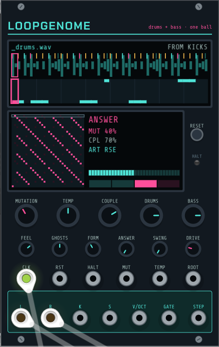

# LOOPGENOME

*Drums and neuro bass learned as one loop; one Pinball ball picks the drum slice and the bass articulation*

16 HP — Sampler · Drum · Sequencer · Synth voice · Random · Stereo

LOOPGENOME learns drums and bass as one loop, ported from the LOOPGENOME plugin on top of GENOTYPE and BREAKDNA. Every 16th of the break is a joint state: what the drums do there and what the bass does. One Pinball ball walks the loop, and the step it lands on plays the break's hits, that step's bass cell and its articulation (NEUROSTACK's phase-locked neuro bass over one sub), so a jump is a drum switch-up and a bass switch-up at once. Even at MUTATION 100 the SKELETON (kick + snare) stays put. Screens: the break over the bass piano roll; the joint matrix with the articulation row and the form.

**Patch it**
- Load a break from the menu (the bass line can come from its kicks, a style or a WAV bass loop), patch a 1/16 clock into CLK and take L / R (drums + bass). Raise MUTATION, then COUPLE to let the bass decide more of the jumps.
- ROOT (V/oct) sets the bass key, folded to the sub's octave; patch a sequencer there to move it. DRUMS and BASS set the levels, DRIVE drives the bass.
- RESET sends the ball home, HALT stops it until the next reset. K / S triggers, the bass line as V/OCT + GATE and STEP go out to the rest of the rack. Without CLK it runs free at the break's tempo.

## Controls

| group | control | range | default |
|---|---|---|---|
| Walk | Mutation | 0 … 100 | 40 |
| Walk | Temperature | -2 … 2 | 0 |
| Walk | Couple | 0 … 100 | 70 |
| Walk | Swing | 0 … 100 | 0 |
| Walk | Reset the ball (to the start step) | 0 … 1 | 0 |
| Call & response | Form | 0 … 5 | 2 |
| Call & response | Answer | 0 … 3 | 0 |
| Drums | Drums level | -24 … 6 | 0 |
| Drums | Feel | 0 … 150 | 100 |
| Drums | Ghosts | 0 … 200 | 100 |
| Bass | Bass level | -24 … 6 | 0 |
| Bass | Bass drive | 0 … 100 | 25 |

## Inputs and outputs

| inputs | outputs |
|---|---|
| Clock | Left (drums + bass) |
| Reset | Right (drums + bass) |
| Halt (trigger: the ball stops until the next reset) | Kick trigger |
| Mutation CV (10 %/V) | Snare / ghost / perc trigger |
| Temperature CV (0.4 octave/V) | Bass pitch (V/oct, 0 V = C4) |
| Root (V/oct: the bass's key, folded to the sub's octave) | Bass gate |
|  | Step (the ball's step, 0-10 V over the loop) |

[← all modules](../../README.md#modules)
